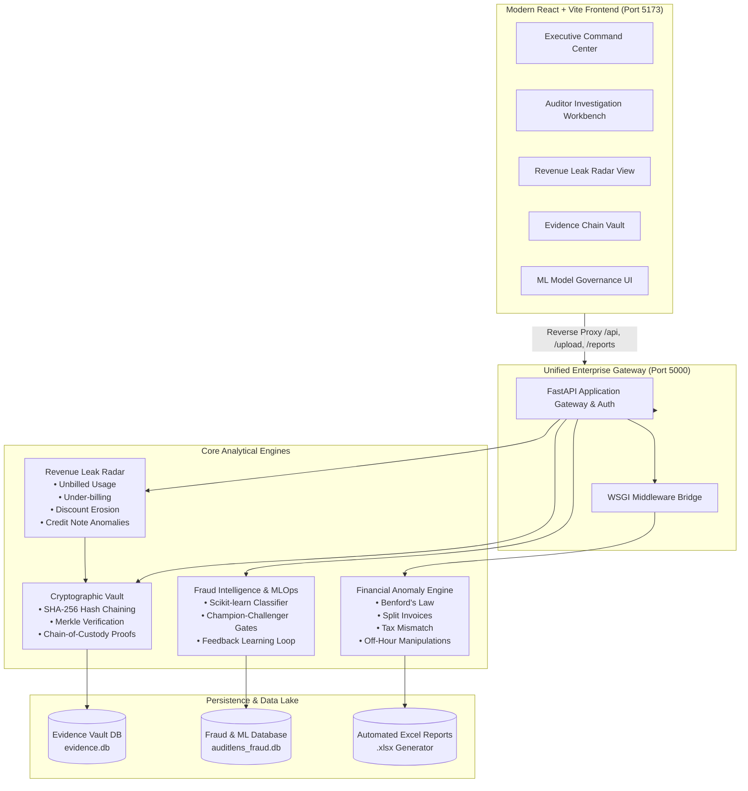

# 🛡️ AuditLens AI — Enterprise Financial Intelligence & Statutory Audit Platform

[](https://www.python.org/)
[](https://fastapi.tiangolo.com/)
[](https://flask.palletsprojects.com/)
[](https://react.dev/)
[](https://vitejs.dev/)
[](#-cryptographic-evidence-chain)
[](#license)

**AuditLens AI** is an enterprise-grade financial anomaly detection, revenue assurance, and statutory audit automation platform. It fuses deterministic audit rules, machine learning fraud intelligence, continuous human-in-the-loop governance, and cryptographic tamper-evident audit trails into a unified executive command center.

---

## 📑 Table of Contents

- [Architectural Overview](#-architectural-overview)
- [Core Platform Pillars](#-core-platform-pillars)
  - [1. Transaction Audit & Anomaly Engine](#1-transaction-audit--anomaly-engine)
  - [2. Revenue Leak Radar (RLR)](#2-revenue-leak-radar-rlr)
  - [3. Cryptographic Evidence Chain](#3-cryptographic-evidence-chain)
  - [4. Fraud Intelligence & MLOps Governance](#4-fraud-intelligence--mlops-governance)
  - [5. Executive Workbench & Forensic UI](#5-executive-workbench--forensic-ui)
- [Project Directory Layout](#-project-directory-layout)
- [Quick Start Guide](#-quick-start-guide)
  - [Prerequisites](#prerequisites)
  - [1-Click Startup (Recommended)](#1-click-startup-recommended)
  - [Manual Execution](#manual-execution)
- [Testing & Verification with Sample Datasets](#-testing--verification-with-sample-datasets)
- [API Reference & Documentation](#-api-reference--documentation)
- [Environment Configuration](#-environment-configuration)
- [Security & Compliance](#-security--compliance)

---

## 🏛️ Architectural Overview



---

## 💎 Core Platform Pillars

### 1. Transaction Audit & Anomaly Engine
- **Benford's Law Compliance**: Evaluates first-digit frequency distribution across ledger transactions to flag artificial rounding or fabricated billing entries.
- **Split-Invoice & Threshold Avoidance**: Uncovers sub-threshold transactions (e.g., $9,950 to evade a $10,000 managerial sign-off requirement).
- **Off-Hours / Weekend Posting**: Detects unauthorized journal entries booked outside standard business hours (`< 06:00` or `>= 23:00`).
- **Statutory Tax & GST Mismatches**: Validates calculation parity between taxable amounts, tax rates, discounts, and final invoice totals.
- **Duplicate Billing & Refund Anomalies**: Detects exact and fuzzy transaction duplicates across vendor accounts, invoice IDs, and refund amounts.
- **Automated Excel Audit Reports**: Generates multi-tab, conditionally formatted `.xlsx` workbooks detailing executive summaries, risk breakdowns, and flag audit logs.

### 2. Revenue Leak Radar (RLR)
- **Leakage Pattern Recognition**: Identifies silent revenue erosion including unbilled usage, rate-card under-billing, abnormal discounts, and unlinked credit notes.
- **Deterministic Rule Base**: Fully transparent, auditable business logic backed by explainable risk-scoring matrices.
- **AI Explanation Service**: Translates complex ledger mismatches into plain-English root causes and quantified recovery suggestions for finance teams.
- **Multi-Format Export**: Generates exportable CSV, Excel, and PDF executive dossiers.

### 3. Cryptographic Evidence Chain
- **Tamper-Evident SHA-256 Chaining**: Creates an append-only ledger of audit findings, where every state transition references previous cryptographic hashes.
- **Merkle Proof Verification**: Enables mathematical certainty that historical audit findings, reports, and evidence files have remained pristine and unaltered.
- **Chain of Custody Tracking**: Records timestamps, investigator identities, action rationale, and cryptographic signatures for litigation and statutory defense.

### 4. Fraud Intelligence & MLOps Governance
- **Autonomous Risk Scoring**: Real-time logistic regression inference pipeline calculating risk probabilities (`0.00 – 1.00`), assigning dynamic tiers (`Low`, `Medium`, `Critical`).
- **Human-in-the-Loop Feedback Learning**: Feeds investigator review outcomes (`Confirmed Fraud`, `Legitimate`, `Inconclusive`) into retraining pipelines without data leakage.
- **Champion-Challenger Gating**: Candidate ML models must beat the active champion across Precision, Recall, and PR-AUC thresholds prior to automated promotion.
- **Zero-Downtime Rollbacks**: Immediate rollback capability to historical model artifacts with strict dataset lineage tracking.

### 5. Executive Workbench & Forensic UI
- **Live KPI Command Center**: Real-time summary cards for total processed volume, flagged anomaly value, recovered revenue, and active cases.
- **Interactive Risk Distribution**: Recharts-powered interactive charts displaying risk score distributions, anomaly types, and risk severity.
- **Auditor Investigation Workbench**: Filter, search, and change review states (`Pending` ➡️ `Reviewed` ➡️ `Escalated`) on the fly.
- **One-Click Instant Demo**: Built-in test harness to analyze pre-configured dirty financial ledgers with a single click.

---

## 📂 Project Directory Layout

```plaintext
Auditlens_AI/
│
├── .gitignore                                 # Production git exclusions (large zips, .venv, node_modules)
├── README.md                                  # Platform master documentation
├── run_all.bat                                # 1-click startup (Backend + Frontend)
├── run_backend.bat                            # Launch backend service on :5000
├── run_frontend.bat                           # Launch Vite frontend on :5173
├── test_backend.bat                           # Execute backend unit test suites
├── financial_fraud_dirty_dataset.csv          # Comprehensive fraud test dataset
├── sample_revenue_ledger.csv                  # Sample ledger for Revenue Leak Radar
├── sample_transactions.csv                    # Sample transaction dataset for statutory audits
│
└── Auditlens_AI/
    ├── unified_backend.py                     # Unified Gateway (FastAPI + Flask WSGI)
    ├── auditlens_fraud.db                     # SQLite database for ML & Fraud Cases
    │
    ├── backend/                               # Transaction Audit Engine (Flask)
    │   ├── audit_engine/
    │   │   ├── audit_analysis.py              # Anomaly detection & Excel reporting engine
    │   │   ├── sample_transactions.csv
    │   │   ├── uploads/                       # Temporary transaction uploads
    │   │   └── reports/                       # Generated .xlsx audit reports
    │   └── tests/
    │       └── unit_tests.py                  # Core audit engine unit tests
    │
    ├── Revenue_leak_radar/                    # Revenue Assurance Module (FastAPI)
    │   ├── main.py                            # Standalone entry point
    │   ├── revenue_leak_radar/
    │   │   ├── router.py                      # RLR API route handlers
    │   │   ├── schemas.py                     # Pydantic data schemas
    │   │   └── services/                      # Detection rules, AI explanations, risk scoring
    │   └── tests/                             # Rule & API test suites
    │
    ├── evidence-chain/                        # Cryptographic Proof Vault (FastAPI)
    │   ├── main.py                            # SHA-256 evidence chain API & verification
    │   └── evidence_files/                    # Cryptographically sealed evidence blobs
    │
    ├── auditlens_backend/                     # Fraud ML & Model Governance (FastAPI)
    │   ├── auditlens_backend.py               # ML training, prediction, & case management
    │   └── tests/                             # ML governance unit tests
    │
    └── frontend/                              # Enterprise React + Vite Single Page App
        ├── index.html                         # Entry HTML
        ├── vite.config.js                     # Vite dev server & reverse proxy configuration
        ├── package.json                       # Dependencies (React, Recharts, Chart.js, Axios)
        └── src/
            ├── App.css                        # Glassmorphic responsive styling
            └── components/
                ├── Dashboard.js               # Executive KPI & overview cards
                ├── Investigation.js           # Auditor investigation workbench
                ├── AuditTable.js              # Anomaly ledger data table
                ├── AuditSummary.js            # Risk summary charts & cards
                ├── RevenueLeakRadar.js        # Revenue assurance radar UI
                ├── EvidenceChain.js           # Cryptographic evidence explorer
                ├── FraudIntelligence.js       # ML model governance & case tracker
                ├── SystemStatus.js            # Microservice health monitoring
                └── fileUpload.js              # Multi-file drag & drop analysis loader
```

---

## 🚀 Quick Start Guide

### Prerequisites
- **Python**: 3.11, 3.12, or 3.13 installed
- **Node.js**: v18+ and `npm` installed
- **Git**: Installed and configured

### 1-Click Startup (Recommended)

Simply run `run_all.bat` from PowerShell or double-click it in Windows File Explorer:

```powershell
.\run_all.bat
```

This will launch two terminal windows:
1. **AuditLens Unified API Server** on `http://127.0.0.1:5000`
2. **AuditLens UI Dashboard** on `http://localhost:5173`

---

### Manual Execution

#### 1. Start Unified Backend
```powershell
cd Auditlens_AI
.\.venv\Scripts\python.exe unified_backend.py
```
> *API interactive Swagger documentation is available at:* `http://127.0.0.1:5000/docs`

#### 2. Start Frontend Dev Server
```powershell
cd Auditlens_AI\frontend
npm run dev
```
> *Access the web dashboard in your browser:* `http://localhost:5173`

#### 3. Run Backend Test Suite
```powershell
cd Auditlens_AI
.\.venv\Scripts\python.exe -m unittest backend.tests.unit_tests
```

---

## 🧪 Testing & Verification with Sample Datasets

The repository includes pre-packaged dirty test datasets containing engineered fraud patterns:

1. **One-Click Instant Analysis**:
   - Open `http://localhost:5173`.
   - Click the **"✨ Load Sample Data"** button on the dashboard.
   - The engine will immediately run Benford's Law analysis, off-hour checks, split-invoice detection, and present interactive risk charts.

2. **Custom File Upload Analysis**:
   - Click **"📁 Choose Files"** and select `sample_transactions.csv` or `financial_fraud_dirty_dataset.csv`.
   - Click **"🚀 Upload & Analyze"**.
   - Review flagged items in the **Auditor Investigation Workbench**.
   - Change finding statuses between `Pending`, `Reviewed`, and `Escalated`.
   - Click **"📥 Download Audit Report (.xlsx)"** to export findings into an Excel workbook.

3. **Revenue Leak Radar Demo**:
   - Navigate to the **Revenue Leak Radar** tab.
   - Click **"Analyze Sample Ledger"** to see unbilled usage, under-billing, and discount erosion findings with AI explanations.

4. **Cryptographic Proof Verification**:
   - Open the **Evidence Chain** tab to inspect SHA-256 block hashes, previous block linkages, and verify evidence integrity.

---

## 🔌 API Reference & Documentation

When the unified backend is running, full interactive OpenAPI / Swagger specifications are available at `http://127.0.0.1:5000/docs`.

### Primary Endpoints:

| Category | Method | Endpoint | Description |
| :--- | :--- | :--- | :--- |
| **System** | `GET` | `/health` | Health status of all platform micro-engines |
| **Audit Engine** | `POST` | `/upload` | Upload CSV ledger and trigger anomaly detection |
| **Audit Engine** | `GET` | `/sample-data` | Retrieve pre-analyzed demo audit dataset |
| **Audit Engine** | `GET` | `/reports/{filename}` | Download generated Excel audit report |
| **Revenue Leak** | `GET` | `/api/revenue-leak-radar/rules` | List all active revenue leakage detection rules |
| **Revenue Leak** | `POST` | `/api/revenue-leak-radar/analyze` | Execute revenue assurance analysis on a ledger job |
| **Revenue Leak** | `GET` | `/api/revenue-leak-radar/demo-analyze` | Instant 1-click execution on sample revenue ledger |
| **Evidence Chain** | `POST` | `/api/evidence-chain/events` | Record a tamper-evident audit event with SHA-256 |
| **Evidence Chain** | `GET` | `/api/evidence-chain/verify/{id}` | Cryptographically verify the integrity of an audit record |
| **Fraud ML** | `POST` | `/api/predictions` | Real-time ML fraud scoring on transaction payloads |
| **Fraud ML** | `GET` | `/api/fraud-cases` | Filter investigation case registry |
| **Fraud ML** | `POST` | `/api/fraud-cases/{id}/resolve` | Record auditor case resolution and recovered amount |
| **ML Governance** | `GET` | `/api/ml/metrics` | Champion model metrics, training jobs, candidate gates |
| **ML Governance** | `POST` | `/api/ml/models/{v}/promote` | Promote challenger model to active Champion |

---

## ⚙️ Environment Configuration

Default configuration operates seamlessly out-of-the-box in local development. For production deployments, configure via environment variables:

```ini
# Server Configuration
APP_ENV=production
PORT=5000

# Database Connections
DATABASE_URL=sqlite:///Auditlens_AI/auditlens_fraud.db
REVAI_EVIDENCE_CHAIN_URL=http://127.0.0.1:5000/api/evidence-chain

# Storage Directories
ARTIFACT_DIR=Auditlens_AI/artifacts
UPLOAD_DIR=Auditlens_AI/backend/audit_engine/uploads
REPORTS_DIR=Auditlens_AI/backend/audit_engine/reports

# Authentication Tokens (JSON Map)
API_TOKENS_JSON={"admin-token":{"identity":"admin@auditlens.ai","role":"admin"},"analyst-token":{"identity":"analyst@auditlens.ai","role":"analyst"}}
```

---

## 🔒 Security & Compliance

- **Statutory Audit Defense**: Cryptographically verifiable evidence records prevent retroactive tampering of findings.
- **Model Explainability**: All anomaly findings feature clear deterministic rule descriptions alongside ML feature weights.
- **Zero Data Leakage**: ML retraining pipelines strictly isolate training data temporally from evaluation records.
- **Role-Based Access**: Multi-tiered authentication supporting `admin`, `analyst`, and `reviewer` roles.

---

## 📄 License

This software and its associated documentation are proprietary and confidential. Unauthorized copying, distribution, or deployment is strictly prohibited.
